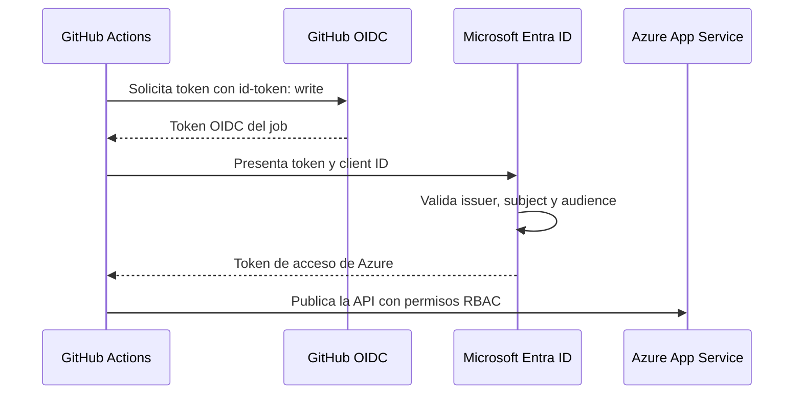

  
  <h1>GitHub Actions → Azure</h1>
  
<strong>Despliega con identidad. No con un client secret.</strong>

  
Un laboratorio de referencia de OIDC, Microsoft Entra ID y Azure App Service.

  
<strong>.NET 10 · GitHub Actions · Workload Identity Federation</strong>

  

    <a href="#-el-laboratorio">El laboratorio</a> ·
    <a href="#-cómo-funciona">Cómo funciona</a> ·
    <a href="docs/azure-oidc-guide.md">Guía paso a paso</a> ·
    <a href="docs/azure-oidc-guide.md#errores-comunes">Solucionar errores</a>
  

## 🧭 El laboratorio

Este repositorio muestra cómo publicar una API ASP.NET Core en **Azure App Service sin almacenar un client secret de Azure en GitHub**. El job solicita un token OIDC; Microsoft Entra ID valida la confianza configurada y entrega un token de acceso para el despliegue.

La API procede de [dotnet-clean-architecture](https://github.com/mbarretot/dotnet-clean-architecture). Aquí el foco es la **identidad del pipeline**, no desplegar toda la plataforma de la aplicación.

| Aprenderás a… | Dónde verlo |
| --- | --- |
| Sustituir un client secret por federación | [Workflow anterior](docs/workflows-antes/deploy-client-secret.yml) → [workflow activo](.github/workflows/deploy.yml) |
| Limitar el rol de despliegue a una Web App | [Identidad y permisos](docs/azure-oidc-guide.md#2-app-registration-service-principal-y-rol) |
| Configurar el subject correcto para `production` | [Credencial federada](docs/azure-oidc-guide.md#3-credencial-federada) |
| Diagnosticar subjects, audiencias y permisos | [Errores comunes](docs/azure-oidc-guide.md#errores-comunes) |

> [!IMPORTANT]
> Es un ejemplo educativo, no una plataforma lista para producción. El despliegue mínimo desactiva las migraciones y comprueba `/alive`; no configura PostgreSQL ni la autenticación de usuarios de la API. Un `200` en esa ruta no demuestra que los endpoints de negocio funcionen.

## 🔐 Cómo funciona

**Confianza y autorización son cosas distintas:** la credencial federada permite autenticarse; Azure RBAC determina qué puede hacer esa identidad. Consulta la [guía de OIDC en Azure de GitHub](https://docs.github.com/en/actions/how-tos/secure-your-work/security-harden-deployments/oidc-in-azure).

| Antes: client secret | Después: OIDC |
| --- | --- |
| Credencial persistente almacenada en GitHub | Token del job y confianza federada |
| Hay que gestionar la caducidad del secreto | No hay client secret que renovar |
| Login mediante `creds` | Login mediante `client-id`, `tenant-id` y `subscription-id` |

El workflow actual sigue usando tres **GitHub Secrets para identificadores**, no para una contraseña. “Sin client secret” no significa que no existan credenciales temporales ni configuración que proteger.

## 🚀 Reproducirlo

1. Haz un fork y revisa los [requisitos y costes](docs/azure-oidc-guide.md#antes-de-empezar).
2. Sigue la [guía de despliegue](docs/azure-oidc-guide.md): infraestructura, identidad, confianza y configuración de GitHub.
3. Ejecuta el workflow, verifica `/alive` y [elimina tus recursos](docs/azure-oidc-guide.md#limpieza) al terminar.

> [!TIP]
> El job activo declara `environment: production`. Su credencial federada debe usar ese entorno, **no** el subject de la rama `main`. Configura también las reglas del entorno para controlar desde qué ramas se permite desplegar.

## 🗺️ Mapa del repositorio

| Ruta | Papel en este ejemplo |
| --- | --- |
| [`.github/workflows/deploy.yml`](.github/workflows/deploy.yml) | Publica Presentation y despliega con OIDC |
| [`docs/azure-oidc-guide.md`](docs/azure-oidc-guide.md) | Configuración reproducible, diagnóstico y limpieza |
| [`docs/workflows-antes/`](docs/workflows-antes/) | Login anterior, solo como referencia; no se ejecuta |
| [`src/CleanArchitecture.Presentation/`](src/CleanArchitecture.Presentation/) | API ASP.NET Core que se publica |
| [`docs/adr/`](docs/adr/) | Decisiones de arquitectura de la aplicación base |

Los proyectos Aspire y los archivos Terraform pertenecen a la aplicación base; **el workflow de este laboratorio no los ejecuta**. Para explorar esa aplicación, consulta su [guía de desarrollo](docs/development-guide.md) y su [guía de API](docs/api-guide.md).

## 📚 Para seguir aprendiendo

- [GitHub: OpenID Connect](https://docs.github.com/en/actions/concepts/security/openid-connect) y [subjects inmutables](https://github.blog/changelog/2026-04-23-immutable-subject-claims-for-github-actions-oidc-tokens/).
- [Microsoft: confianza federada](https://learn.microsoft.com/entra/workload-id/workload-identity-federation-create-trust) y [despliegue en App Service](https://learn.microsoft.com/azure/app-service/deploy-github-actions).
- [`azure/login`](https://github.com/Azure/login): parámetros y ejemplos oficiales.

Proyecto de referencia bajo [MIT](LICENSE): puedes reutilizarlo y adaptarlo conservando el aviso de copyright y la licencia; se entrega sin garantías. Los avisos de terceros en [`docs/assets/logos/`](docs/assets/logos/) se conservan. Proyecto independiente, sin afiliación con Microsoft ni GitHub.
